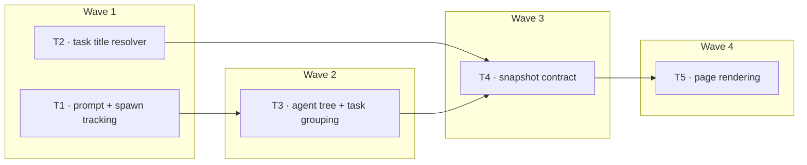

# Plan: Monitor task-based boxes

Requirements: `.claude/work-items/monitor-work-areas/spec.md`

## Requirements covered

- R1 — Each session is a bordered region labelled with its inferred goal.
- R2 — One main box per task, a task being the work started by one user prompt, ordered oldest first.
- R3 — Helper boxes connect to the box of the agent that spawned them, nested to real depth.
- R4 — Boxes show only their work text and nothing else.
- R5 — Finished work stays on screen with a static cross at its top-left corner.
- R6 — No box is dropped while its session is live.

## Codebase context

- The transcript reader already parses prompt lines and keeps `lastPromptAt`, so prompt boundaries are available but only the most recent is retained. (`monitor/lib/transcript-reader.js:67`, `monitor/lib/transcript-reader.js:77`)
- The reader holds per-file incremental state keyed by inode and consumes only newly appended bytes, so any new accumulation must be append-safe. (`monitor/lib/transcript-reader.js:128`, `monitor/lib/transcript-reader.js:150`)
- The subagent reader already records `spawnedAt` from the meta file's mtime, which is what dates an agent into a task. (`monitor/lib/subagents.js:40`)
- An agent's parent is derivable because the child's `toolUseId` appears in the spawner's transcript; nothing records it directly. (spec F3)
- Agent state resolution is settled and must not be re-litigated: an agent is finished only when its transcript's turn closed terminally or the session outlived it. (`monitor/lib/subagents.js:22`, `monitor/lib/subagents.js:29`)
- `describeSession` assembles the session record and is where a `tasks[]` field joins the contract. (`monitor/lib/snapshot.js:25`)
- Goal inference already shells out to the `claude` CLI behind a queue, a disk cache and a failure backoff; per-task titles must reuse it rather than open a second path to the CLI. (`monitor/lib/session-goal.js`)
- Tests are `node:test` files, one per module, building synthetic temp directories through shared helpers and never reading the real `~/.claude`. (`monitor/test/helpers.js`, `monitor/test/snapshot.test.js`)
- The page builds DOM through a small `el()` helper and re-renders from each snapshot; there is no framework. (`monitor/public/index.html`)

Project commands:

- Build: none (no build step; the page is served as written)
- Test: `node --test monitor/test/`
- Lint / type check: none configured

## Decisions

- D1 — A task's main box is the single session-spawned agent when the task has exactly one, and the session itself when it has none or several. Why: this reproduces the spec's worked example — one delegated `/dev` agent owns its task, while several helper agents mean the session is driving — and both counts are derivable from the spawn tree. Decided by: agent, following spec D1 and R4.AC2/AC3.
- D2 — Parent links are built by collecting, per transcript, the `toolUseId` of every Agent tool use it issues, then matching each agent's own `toolUseId` against those sets. Why: it is the only recorded link (spec F3) and it rides on the existing incremental read rather than re-scanning whole files. Decided by: agent, following `monitor/lib/transcript-reader.js:128`.
- D3 — Prompt timestamps accumulate in an array on the transcript state, capped at the most recent 200. Why: tasks are per prompt and a long session would otherwise grow the state without bound; 200 is far beyond any observed session's prompt count. Decided by: agent, following `monitor/lib/transcript-reader.js:18`.
- D4 — An agent is dated into a task by `spawnedAt` against prompt timestamps, choosing the latest prompt at or before it. Why: `spawnedAt` is already recorded (`monitor/lib/subagents.js:40`) and needs no new source. Decided by: agent.
- D5 — Per-task titles reuse the existing goal resolver by generalising it to take a cache key and a list of descriptions, rather than adding a second CLI path. Why: the resolver already owns the queue, timeout, disk cache and backoff that any CLI call needs. Decided by: agent, following `monitor/lib/session-goal.js`.
- D6 — The page renders a task's helpers as a nested list reflecting real spawn depth, with connectors drawn in CSS from the existing `--line` token. Why: spec R3.AC2 requires true depth, and the current page already draws spine-and-elbow connectors this way. Decided by: agent, following spec D2.

## Waves

| Wave | Tasks  | Runs after |
| ---- | ------ | ---------- |
| 1    | T1, T2 | —          |
| 2    | T3     | Wave 1     |
| 3    | T4     | Wave 2     |
| 4    | T5     | Wave 3     |

## Tasks

### T1 — Record prompt boundaries and spawn tool ids

- Wave: 1
- Covers: R2, R3
- Files: `monitor/lib/transcript-reader.js` (modify), `monitor/test/transcript-reader.test.js` (modify)
- Units:
  - `emptyState() -> state` — extend the returned state with `promptAts: number[]` (ascending, capped at the most recent 200) and `spawnedToolUseIds: Set<string>`.
- Depends on: —
- Approach: in `applyUserLine`, push the parsed timestamp onto `promptAts` as well as setting `lastPromptAt`, trimming from the front past 200. In `applyAssistantLine`, walk the message's content blocks and, for every block of type `tool_use` whose `name` is the Agent tool, add its `id` to `spawnedToolUseIds`. Both accumulate across incremental reads, so they must be carried on the per-inode entry state exactly as `tokens` already is. Keep `lastPromptAt` working unchanged — `task-title.js` and `snapshot.js` read it.
- Done when: new tests cover a transcript with three prompts yielding three ascending `promptAts`, the 200 cap dropping the oldest, an Agent tool use adding its id, a non-Agent tool use not adding one, and accumulation across two incremental reads of an appended file; `node --test monitor/test/` passes.

### T2 — Generalise the goal resolver to arbitrary titles

- Wave: 1
- Covers: R4
- Files: `monitor/lib/session-goal.js` (modify), `monitor/test/session-goal.test.js` (modify)
- Units:
  - `createGoalResolver(options) -> resolver` — unchanged signature; the returned object gains `resolveTitle(cacheKey, descriptions, options) -> string | null`.
  - `resolveTitle(cacheKey, descriptions, { minimumDescriptions }) -> string | null` — returns the cached title for `cacheKey` immediately, enqueueing one CLI generation when the existing regeneration thresholds allow; never blocks.
- Depends on: —
- Approach: lift the existing per-session logic into a keyed form so the cache file holds one entry per arbitrary key rather than per session id, and express `resolveGoal` in terms of `resolveTitle` so there is one code path. Keep every existing rail untouched: one child at a time, 60s kill, 40-description cap, the regeneration thresholds, the 30-minute failure backoff, descriptions-only prompts, and the env overrides for CLI path and model. `minimumDescriptions` defaults to the current behaviour of skipping fewer than 2.
- Done when: existing session-goal tests pass unchanged against the refactor, new tests cover two distinct cache keys not colliding and `minimumDescriptions: 1` allowing a single-description title; `node --test monitor/test/` passes.

### T3 — Build the agent tree and group agents into tasks

- Wave: 2
- Covers: R2, R3, R5, R6
- Files: `monitor/lib/tasks.js` (create), `monitor/test/tasks.test.js` (create)
- Units:
  - `buildAgentTree(agents, spawnerSets) -> Map<agentId, agentId | null>` — maps each agent to its parent agent id, or null when the session spawned it, by matching the agent's `toolUseId` against each spawner's `spawnedToolUseIds`.
  - `groupIntoTasks(agents, promptAts, parentOf) -> task[]` — returns one task per prompt that produced work, ascending by prompt time, each `{ taskId, startedAt, rootAgentId, agentIds }`.
  - `mainBoxOf(task, parentOf) -> { kind: 'agent' | 'session', agentId: string | null }` — the single session-spawned agent when the task has exactly one, otherwise the session.
- Depends on: T1
- Approach: a new pure module taking plain data and returning plain data, in the style of `repo-root.js` — no file system, no clock. `buildAgentTree` needs each agent's own `toolUseId`, so the subagent reader's existing meta read must pass it through; add it to the agent record in this task's own file only if `subagents.js` does not already expose it, otherwise read it as given. A task owns the agents whose `spawnedAt` falls at or after its prompt and before the next. A prompt with no agents and no tool use produces no task, per R2.AC3.
- Done when: tests cover the spec's worked example (one task with a single delegated agent that has two children; another task with several session-spawned helpers), a three-level tree resolving to the right parents, an agent spawned before any prompt, a prompt producing no task, and the ordering being oldest first; `node --test monitor/test/` passes.

### T4 — Put tasks on the snapshot

- Wave: 3
- Covers: R1, R2, R3, R4, R5, R6
- Files: `monitor/lib/snapshot.js` (modify), `monitor/lib/subagents.js` (modify), `monitor/test/snapshot.test.js` (modify)
- Units:
  - `describeSession(record, repoRoot, transcriptState, agents, goal, tasks) -> session` — the session record gains `tasks: task[]`.
  - Each task on the wire: `{ taskId, startedAt, title, titleSource, main: { kind, agentId, state }, agents: [{ agentId, parentAgentId, description, state, depth }] }`.
- Depends on: T2, T3
- Approach: have `subagents.js` carry each agent's `toolUseId` and its transcript's `spawnedToolUseIds` through on the agent record, since it already reads both the meta file and the transcript. In `snapshot.js`, call `buildAgentTree` and `groupIntoTasks`, then resolve each task's title: the main agent's `description` when the main box is an agent, otherwise `resolveTitle` keyed on the task id over that task's descriptions. Keep `agents[]`, `goal`, `summary` and every existing field on the session exactly as they are — this task adds, it does not remove. A task's state is finished when every agent in it is finished and it is not the session's current task.
- Done when: snapshot tests cover a session whose tasks reproduce the spec's worked example, a task titled from its single delegated agent, a task titled through the resolver, a finished task staying in the list, and the existing session fields being unchanged; `node --test monitor/test/` passes.

### T5 — Render borders, task boxes and connected helpers

- Wave: 4
- Covers: R1, R2, R3, R4, R5, R6
- Files: `monitor/public/index.html` (modify)
- Units: —
- Depends on: T4
- Approach: replace the current per-session card and flat agent grid with: one bordered region per session carrying the session's `goal` as a quiet label (R1.AC3); inside it, one main box per task in `tasks[]` order; under each main box, its helpers as a nested structure following `parentAgentId` and `depth`, connected with CSS borders from the existing `--line` token as the current spine-and-elbow does. Each box renders its text only (R4) plus a static `×` at the top-left when its state is finished (R5), with no click handler. Keep every standing constraint: nothing sticky or fixed, no sideways body scroll at 375/768/1280, text wraps rather than truncating, the pitch-black `#16C60C` dark theme and the light theme both intact, and `prefers-reduced-motion` respected. Delete the CSS and JS left orphaned by the removed card layout.
- Done when: rendered against a fixture exercising the spec's worked example, the page shows two bordered regions with two main boxes in the first and one in the second, helpers connected at their true depth, crosses on finished boxes only, no sideways scroll at all three widths, and `node --test monitor/test/` still passes.
