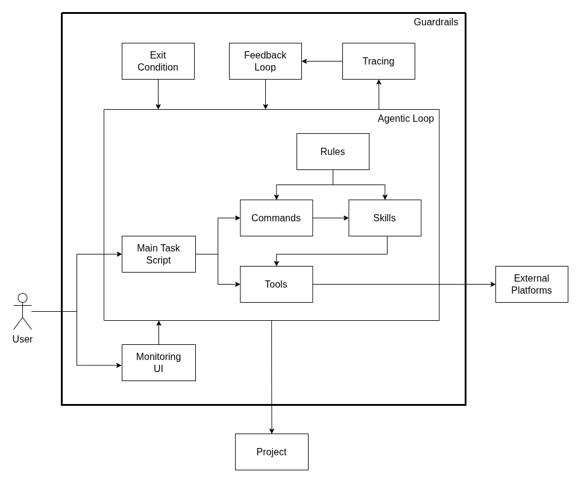

<pre>
██╗  ██╗ █████╗ ██████╗ ███╗   ██╗███████╗███████╗███████╗
██║  ██║██╔══██╗██╔══██╗████╗  ██║██╔════╝██╔════╝██╔════╝
███████║███████║██████╔╝██╔██╗ ██║█████╗  ███████╗███████╗
██╔══██║██╔══██║██╔══██╗██║╚██╗██║██╔══╝  ╚════██║╚════██║
██║  ██║██║  ██║██║  ██║██║ ╚████║███████╗███████║███████║
╚═╝  ╚═╝╚═╝  ╚═╝╚═╝  ╚═╝╚═╝  ╚═══╝╚══════╝╚══════╝╚══════╝
</pre>

## Description

Harness is a reusable, self-improving [Claude Code](https://claude.com/claude-code) harness: a self-contained set of skills, rules and config that lives entirely under a project's `.claude/` folder.



## Features

- **`/skill-improve`** (this repo only): scores the harness skills, learns from similar skills elsewhere and keeps only the changes that raise the score.

## Skills and commands

- **`/dev`**: Takes requirements all the way to implemented, tested changes by running write-spec, write-plan, implement-requirements and test-changes in order, then a clean-code check, fixes and a second test pass.
- **`/write-spec`**: Turns requirements into a complete, unambiguous specification, asking about every gap.
- **`/write-plan`**: Researches the codebase and writes a plan of file-specific tasks grouped into parallel waves.
- **`/implement-requirements`**: Changes the project's files until every requirement is proven met against a verification checklist.
- **`/test-changes`**: Tests the uncommitted changes end to end: runs the related tests, gets what the change broke fixed, updates the tests in the project's style and meets its coverage threshold.
- **`/run-tests`**: Runs the tests related to the uncommitted changes, or the full suite, and reports which pass and which fail.
- **`/triage-test-failures`**: Sorts failing tests into expected, already failing and broken by the change, checking each against the original code.
- **`/update-tests`**: Writes tests for the changed code in the project's style, removes tests for removed behaviour, and covers given uncovered lines.
- **`/check-coverage`**: Measures coverage against the project's threshold and reports what the change leaves uncovered.
- **`/onboard`**: Maps a project's architecture (files, imports, entry points, tiers) as an interactive HTML map.
- **`/scan`**: Scans a project for its commands, its own conventions and clean-code practices, and its test setup, and writes them to the project's config and rules.
- **`/scan-commands`**: Finds the project's install, run, build, test and other commands and stores them in one YAML file.
- **`/scan-conventions`**: Finds the conventions and clean-code practices a project actually follows and writes them as rule files, keeping hand-written rules.
- **`/scan-test-setup`**: Finds how a project's tests map to source files and its coverage threshold, and stores them in one YAML file.
- **`/check-clean-code`**: Checks code against the clean-code rules and writes a Markdown report; never edits code.
- **`/verify-claims`**: Verifies claims about code rigorously with multiple agents and evidence-backed answers.
- **`/draw-runbook`**: Works out how to run a project locally and draws it as an interactive HTML runbook, with every command traced to the repository.
- **`/monitor`**: Starts a local, read-only dashboard of the project's live Claude Code sessions and subagents.
- **`/commit`**: Suggests one commit message for the staged files; never runs git.
- **`/commits`**: Groups unstaged changes into logical commits and outputs the commands to run; never runs them.

## How to run the project?

From the root of the project that should get the harness, run:

```bash
curl -fsSL https://raw.githubusercontent.com/busycaesar/Harness/Master/install.sh | bash
```

This installs the harness into the project's `.claude/` folder. Run it again to update the harness. Files in `.claude/config/` and `.claude/rules/project/` are never overwritten, so your project's settings and rules survive updates.

Then open Claude Code in that project. The skills are available as slash commands.

## Author

[Dev J. Shah](https://github.com/busycaesar)
